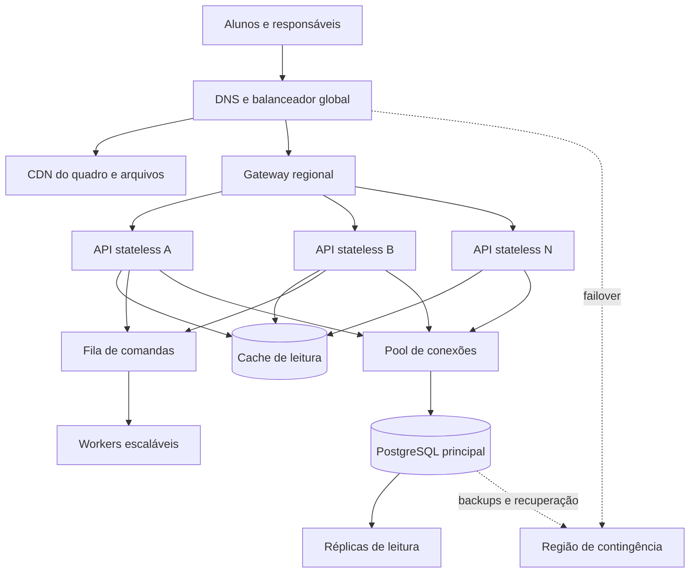

# Um cenário de escala nacional (conceitual)

O sistema desta atividade roda num computador com uma instância de API e PostgreSQL. Para imaginar um milhão de usuários, com cem mil simultâneos, eu separaria a entrada de tráfego, a aplicação e o armazenamento em camadas independentes.

Um balanceador distribuiria requisições entre regiões e réplicas stateless da API. Um orquestrador poderia ajustar réplicas conforme latência, CPU e tamanho da fila. A CDN aproximaria arquivos estáticos dos usuários. Para pedidos, filas permitiriam absorver picos e workers fariam tarefas desacopladas, preservando confirmação rápida para o cliente.

No banco, pool de conexões evitaria abrir uma conexão por chamada; réplicas ajudariam nas leituras do cardápio; particionamento dependeria de métricas e da estratégia de dados. Cache teria invalidação explícita quando preço ou disponibilidade fossem alterados. Observabilidade, alertas, backups testados e recuperação entre regiões seriam parte do desenho.

Esse cenário é uma proposta de arquitetura, não um resultado de carga nem algo provisionado pelo Compose atual.

